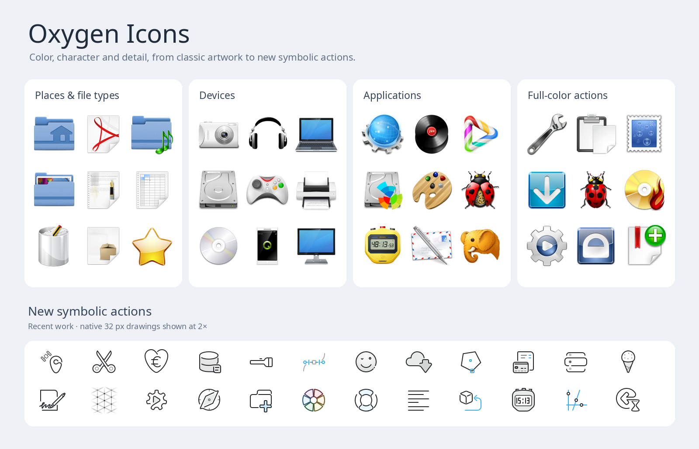

# Oxygen Icons

Oxygen is KDE's detailed, full-color icon theme. It brings a consistent visual
language to applications, folders, files, devices and everyday desktop actions,
using familiar objects, rich materials, smooth gradients, soft shadows and a
slightly glossy look.

Originally developed alongside the Oxygen widget style for the KDE Plasma
desktop, the theme follows the freedesktop.org icon theme conventions and can
also be used by other desktops and applications that support them. The icon
theme can be selected independently of the widget style.



## The artwork

Oxygen gives icons depth and character while keeping their purpose recognizable.
Metal, glass, paper and other materials help distinguish objects; color and
silhouette make related actions and file types easier to identify.

Most icons are drawn afresh for each size. Each drawing has its own geometry,
proportions and level of detail, composed for the pixels available at that
resolution. Small versions keep their clarity in menus, toolbars and lists;
larger versions have room for richer illustration and material detail.

The collection includes:

- **Applications:** identities for KDE applications and other desktop software.
- **Places:** home folders, documents, music, pictures, network locations and trash.
- **File types:** documents, images, audio, video, archives and development files.
- **Devices:** computers, phones, cameras, storage, printers and audio equipment.
- **Actions:** editing, navigation, communication, playback and desktop controls.
- **Status and supporting artwork:** notifications, emblems, categories and more.

Oxygen continues to grow through new application icons, revised artwork and
broader coverage of application actions.

## Symbolic icons

Alongside the traditional full-color artwork, the repository includes symbolic
icons for desktop applets and a growing collection of application actions.
These use fine contours, restrained fills and selective accents, carrying the
Oxygen character into compact interfaces. Theme-aware SVG colors let them
follow the application's color scheme.

Symbolic action coverage is still being developed; the proposed settings for choosing between colorful
and symbolic actions are described separately below.

## Using Oxygen

Install the Oxygen icon theme through your distribution's package manager,
then select **Oxygen** in your desktop's icon-theme settings. On KDE Plasma,
use the Icons page in System Settings. Other compatible desktops provide their
own theme selector.

Applications choose which icon names and sizes they request. Oxygen supplies
the matching artwork where available, with inherited themes providing fallback
icons for names it does not cover. An application's bundled artwork or custom
icon loader may behave differently.

## Installing without building

Oxygen is an artwork theme and can be installed without compiling anything.
Create a `.tar.gz` containing a single `Oxygen/` folder with:

- `index.theme`
- `icon-settings.json`
- The artwork folders listed in the `Directories=` entry of `index.theme`, preserving their relative paths.

Build files, documentation and editable artwork sources from `scalable/` are
not needed for installation. Keep symbolic artwork and icon aliases intact.

In KDE Plasma, open the Icons page in System Settings, choose **Install from
File**, and select the archive. Then select **Oxygen** and apply it.

Alternatively, extract the `Oxygen/` folder into `~/.local/share/icons/` for a
manual installation under your user account.

The configuration metadata is included for desktops that support it. Normal
use of the theme does not require the experimental configuration interface.

## Building and installing from source

The project uses CMake and KDE Extra CMake Modules (ECM). With the build
dependencies installed, configure and build it with:

```sh
cmake -S . -B build -DCMAKE_INSTALL_PREFIX="$HOME/.local"
cmake --build build
cmake --install build
```

This example installs under your user account. Select Oxygen in your desktop's
icon settings after installation. Packagers can choose a system installation
prefix instead.

Artwork sources live in `scalable/`; raster artwork is organized by size and
category in directories such as `32x32/` and `128x128/`. Desktop applet artwork
is in `applets/`, and symbolic application actions are in `simbolicActions/`
(the directory's existing spelling).

## Contributing

New icons, improvements to existing artwork and reports of missing coverage
are welcome. Please coordinate artwork contributions with the Oxygen team so
that the visual style and licensing remain consistent. See
[CONTRIBUTING](CONTRIBUTING) for contact details and the review process, and
[AUTHORS](AUTHORS) for the people behind the theme.

Licensing information is recorded in [REUSE.toml](REUSE.toml), the
[LICENSES](LICENSES/) directory and the accompanying copyright and license
notices.

## Experimental icon configuration

An optional prototype explores configuring which artwork is installed through
Plasma System Settings. It requires a patched Plasma implementation and is
separate from normal installation and use of Oxygen. Selection of symbolic
rather than colorful application actions is planned but not implemented in
that prototype.

Implementation details, examples and the current limitations are documented in
[Declarative icon configuration](docs/declarative-icon-configuration.md).
